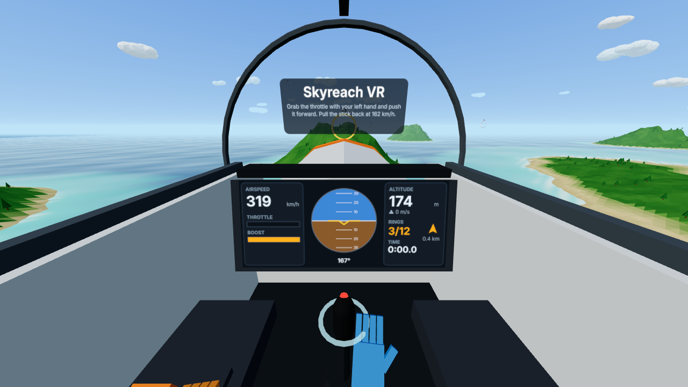

# Skyreach VR

An arcade VR flight sim for **Meta Quest 2** (and Quest 3 / Pro). Take off from an island airstrip, race a jet through 12 rings across a tropical archipelago, then land back on the runway for the best time.

The game comes in two versions that share the same design, physics and world:

| | **WebXR** (`webxr/`) | **Unity** (`unity/`) |
|---|---|---|
| How you play | Open a link in the Quest Browser and press **Enter VR** | Install an APK on the headset (sideload) |
| Setup | None on the headset | Unity 6 on a PC + Quest developer mode |
| Graphics ceiling | Good (Three.js, tuned for 72 fps) | Highest (native Vulkan app) |
| Tested here | ✅ 43 automated tests incl. an emulated Quest 2 | ✅ compiled + 25 logic tests outside Unity; not run in the editor |

Both versions generate **exactly the same islands and ring course** (same seeded random numbers, cross-checked by a test).


| Flying through the archipelago | Chase view (desktop) |
|---|---|
|  |  |

## Features

- Seated cockpit with a **grabbable flight stick and throttle** (squeeze the grip buttons), or thumbstick flying
- Arcade flight model: takeoff, climbing costs speed, stalls, afterburner, landing and crashing
- Procedural archipelago: 9 islands with beaches, forests, rocky peaks and snow, turquoise lagoons, clouds, airstrip with lights and a control tower
- Ring race with timer, best-time record, ring numbers and a "next ring" arrow on the dashboard
- Glass-cockpit display: airspeed, altitude, artificial horizon, heading, throttle, boost, rings, lap time
- Comfort options: comfort vignette (4 levels), automatic seat calibration, re-centre button
- Synthesised engine, wind, chime and crash sounds (no audio files), controller haptics

## Controls (Quest Touch)

| Control | Action |
|---|---|
| **Right grip** (hold) + move hand | Grab the flight stick: pull back = nose up, left/right = roll |
| **Right thumbstick** | Pitch and roll (if you prefer not to grab) |
| **Left grip** (hold) + push/pull | Grab the throttle |
| **Left thumbstick** ↑↓ / ←→ | Throttle / rudder |
| **Right trigger** | Afterburner |
| **Left trigger** | Wheel brakes |
| **A** | Restart (press twice when airborne) |
| **B** or **X** | Cycle comfort vignette: Off / Light / Medium / Strong |
| **Y** | Mute |
| **Click left thumbstick** | Re-centre your seat |

**How to fly:** push the throttle fully forward, wait for 162 km/h, pull the stick back gently. Bank to turn and pull back a little in the turn. Fly through the gold ring. The white rings are the next ones, and the dashboard arrow points to the next ring.

Keyboard (desktop / Unity editor): W/S pitch, A/D roll, Q/E rudder, Shift/Ctrl throttle, Space afterburner, B brakes, V chase camera, Enter restart.

## Quick start

### Play the WebXR version on your Quest

1. Put the game on an **https** address (WebXR only works on secure pages). Pick one:
   - **GitHub Pages:** push this repo to GitHub, then go to *Settings → Pages → Source: GitHub Actions*. The included workflow tests and publishes the game.
   - **Any static host** (Vercel, Netlify, Cloudflare Pages…): run `npm run build` in `webxr/` and upload the `webxr/dist` folder.
   - **From your computer over Wi-Fi:** `cd webxr && npm install && npm run dev:quest`, then open the `https://<your-pc-ip>:5173` address it prints in the Quest Browser and accept the certificate warning (*Advanced → Proceed*).
2. On the Quest, open that address in the **Browser**, press **Enter VR**, and sit down.

More detail: [`webxr/README.md`](webxr/README.md).

### Build the Unity version

1. Install **Unity 6 LTS** with the **Android Build Support** module (Unity Hub → Installs → Add modules).
2. Unity Hub → **Add → Add project from disk** → choose the `unity/` folder.
3. In Unity, use the **Skyreach** menu: *1. Install Quest Packages* → *2. Configure for Meta Quest* → *3. Create Game Scene*.
4. Enable developer mode on the Quest, plug it in by USB, then *Skyreach → 5. Build And Run on Quest*.

Step-by-step guide with troubleshooting: [`unity/README.md`](unity/README.md).

## Folder layout

```
skyreach-vr/
├── README.md                  ← you are here
├── docs/
│   ├── ARCHITECTURE.md        how the code is organised, and how the two versions map
│   ├── TESTING.md             what is tested and how to run it
│   └── images/                screenshots
├── webxr/                     browser version (Three.js + WebXR)
│   ├── index.html             start screen
│   ├── public/                static files (icon)
│   ├── src/
│   │   ├── main.js            boot, Enter VR button, optional headset emulator
│   │   ├── config.js          all tuning values
│   │   ├── core/              game loop, audio, noise, settings storage
│   │   ├── aircraft/          flight model, jet + cockpit
│   │   ├── world/             world data, terrain, ocean, sky, clouds, rings
│   │   ├── input/             Quest controllers, keyboard
│   │   ├── ui/                dashboard HUD, messages, comfort vignette
│   │   └── styles/
│   └── tests/
│       ├── unit/              flight physics, world, full-course autopilot (Node)
│       └── e2e/               browser tests incl. an emulated Quest 2 (Playwright + IWER)
├── unity/                     native Quest version (Unity 6, OpenXR)
│   ├── Assets/Skyreach/
│   │   ├── Scripts/           Core, Aircraft, World, Input, UI, Rendering
│   │   ├── Shaders/           Lit, Ocean, Sky, Unlit, Vignette (single-pass stereo)
│   │   ├── Editor/            "Skyreach" menu: packages, Quest settings, scene, build
│   │   ├── Tests/Editor/      Unity Test Runner (edit mode) tests
│   │   └── Scenes/            created by the Skyreach menu
│   └── Tests~/                compile check + logic tests that run without Unity
└── .github/workflows/         CI: test + publish the WebXR game to GitHub Pages
```
