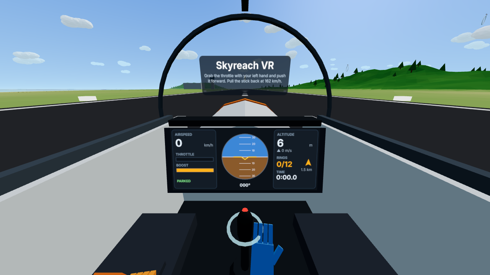
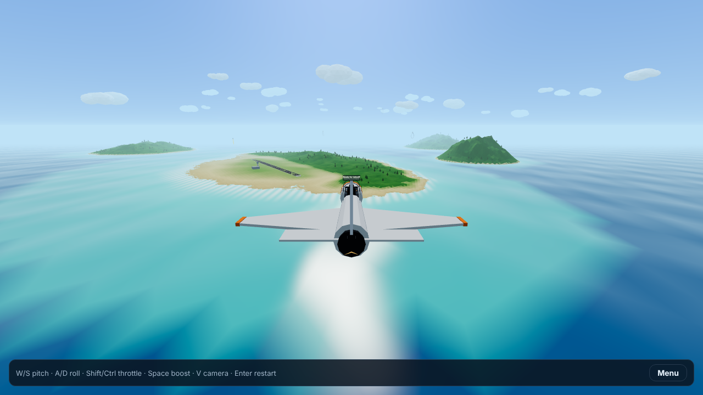
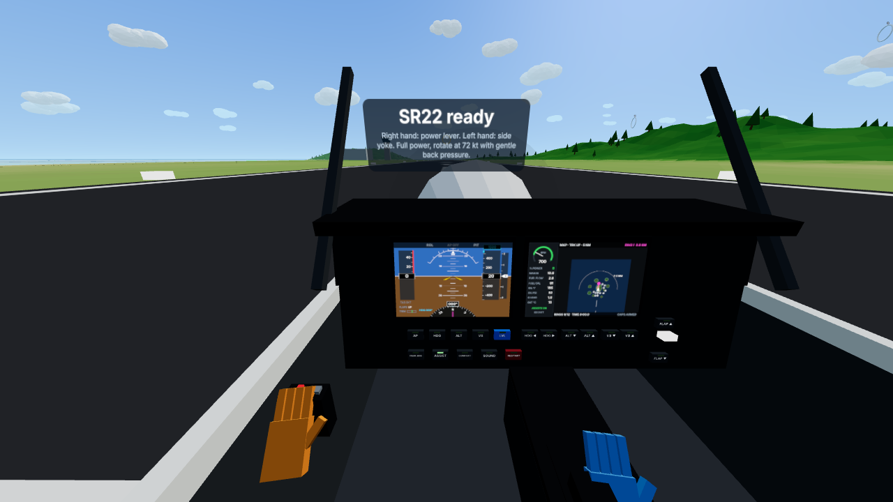
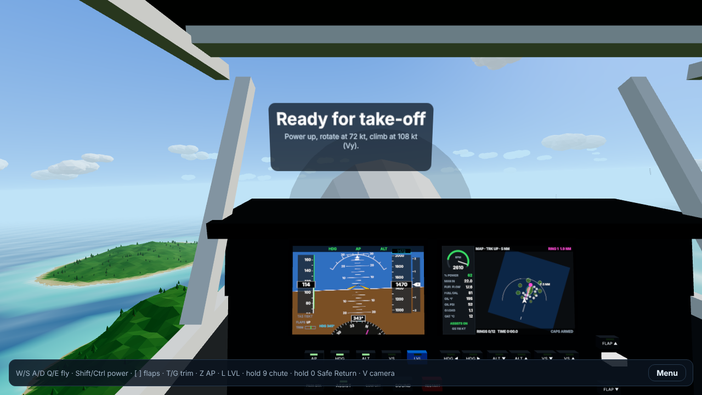

# Skyreach VR

A VR flight sim for **Meta Quest 2** (and Quest 3 / Pro). Take off from an island airstrip, race through 12 rings across a tropical archipelago, then land back on the runway for the best time.

Pick your aircraft on the start screen:

- **Arcade Jet**: fast and forgiving, with an afterburner.
- **SR22-class (realistic)**: modelled on the Cirrus SR22 G7+ (310 hp piston single). It has real performance numbers, a side yoke and power lever, flaps, trim, a glass cockpit, an autopilot, a whole-aircraft parachute and a Safe Return–style emergency autoland. It uses no manufacturer branding.

The game comes in two versions that share the same design, physics and world:

| | **WebXR** (`webxr/`) | **Unity** (`unity/`) |
|---|---|---|
| How you play | Open a link in the Quest Browser and press **Enter VR** | Install an APK on the headset (sideload) |
| Setup | None on the headset | Unity 6 on a PC + Quest developer mode |
| Graphics ceiling | Good (Three.js, tuned for 72 fps) | Highest (native Vulkan app) |
| Aircraft | Arcade Jet + SR22-class | Arcade Jet + SR22-class |
| Tested here | ✅ 88 automated tests incl. an emulated Quest 2 | ✅ compiled + 38 logic tests outside Unity; not run in the editor |

Both versions generate **exactly the same islands and ring course** (same seeded random numbers, cross-checked by a test).



| Flying through the archipelago | Chase view (desktop) |
|---|---|
|  |  |
| **SR22-class cockpit in VR** | **SR22 on autopilot (HDG + ALT)** |
|  |  |

## Features

- Seated cockpit with **grabbable controls** (squeeze the grip buttons) and **fingertip-pressable panel buttons**, plus thumbstick flying
- Procedural archipelago: 9 islands with beaches, forests, rocky peaks and snow, turquoise lagoons, clouds, airstrip with lights and a control tower
- Ring race with timer, best time per aircraft, ring numbers and a "next ring" pointer
- Comfort options: comfort vignette (4 levels), automatic seat calibration, re-centre button
- Synthesised engine, wind, chime, stall-horn, autopilot and crash sounds (no audio files), plus controller vibration

### SR22-class: what's modelled

| | |
|---|---|
| **Flight physics** | Lift and drag from angle of attack, flaps and air density. Book numbers come out of the physics: stall at 70/65/60 kt (flaps up/50%/100%), lift-off around 72 kt, about 1,250 fpm climb at Vy 108 kt, 165–180 kt full power, roughly 9:1 glide. Stalls with wing drop, prop torque, stable phugoid, hard landings, never-exceed overspeed |
| **Controls** | Left-hand **side yoke** (pull = nose up, sideways = roll), right-hand **power lever**, **flaps** UP/50%/100%, **pitch and roll trim hat**, **differential toe brakes** (free-castering nosewheel), parking brake |
| **Glass cockpit** | **PFD**: attitude, speed tape with colour bands, altitude tape with selected-altitude bug, VSI, HSI with heading bug, autopilot modes, flaps/trim, STALL/ESP alerts. **MFD**: track-up moving map with runway, rings and range ring, plus an engine page (RPM, % power, manifold, fuel flow and quantity, G-load) |
| **Autopilot** | AP, HDG (with heading bug), ALT hold, VS with altitude capture, and the blue **LVL** button (wings level, stop the climb or descent). Disconnects if you take the controls or stall |
| **Emergency** | Overhead **parachute handle**: grab it and pull down (works up to its speed limit, about 1,700 fpm descent). Overhead **Safe Return** button: press and hold, and the aircraft flies itself to the runway, lands, brakes and shuts down |
| **Assists** (toggle) | Envelope protection (keeps you out of stalls, steep banks and overspeed), yaw damper, rudder nosewheel steering |

## Controls (Quest Touch)

| | Arcade Jet | SR22-class |
|---|---|---|
| **Grip (hold) + move hand** | Right: flight stick · Left: throttle | Left: side yoke · Right: power lever |
| **Right thumbstick** | Pitch and roll | Pitch and roll |
| **Left thumbstick** | Throttle ↑↓, rudder ←→ | Power ↑↓, rudder ←→ (the **trim hat** while holding the yoke) |
| **Triggers** | Right: afterburner · Left: brakes | Left / right toe brakes |
| **A / B** | Restart / comfort vignette | Flaps down / up |
| **X / Y** | Comfort vignette / mute | Autopilot on-off / **hold** to restart |
| **Fingertip** | – | Panel buttons: AP HDG ALT VS LVL, bugs, flaps, park brake, assists, comfort, sound |
| **Overhead** | – | Pull the red parachute handle · hold the Safe Return button |
| **Click left thumbstick** | Re-centre seat | Re-centre seat |

**Flying the SR22:** push the power lever fully forward and keep straight with gentle rudder. At 72 kt, ease the yoke back. Climb at about 108 kt, and use the trim hat to take the pressure off. To land, use flaps 100% below 110 kt, fly the approach at 80 kt, reduce power over the runway and flare.

Keyboard keys for both aircraft are listed on the start screen (desktop testing: W/S/A/D, Shift/Ctrl, V for the chase camera, and more).

## Quick start

### Play the WebXR version on your Quest

1. Put the game on an **https** address (WebXR only works on secure pages). Pick one:
   - **GitHub Pages:** push this repo to GitHub, then go to *Settings → Pages → Source: GitHub Actions*. The included workflow tests and publishes the game.
   - **Any static host** (Vercel, Netlify, Cloudflare Pages…): run `npm run build` in `webxr/` and upload the `webxr/dist` folder.
   - **From your computer over Wi-Fi:** `cd webxr && npm install && npm run dev:quest`, then open the `https://<your-pc-ip>:5173` address it prints in the Quest Browser and accept the certificate warning (*Advanced → Proceed*).
2. On the Quest, open that address in the **Browser**, press **Enter VR**, and sit down.

More detail: [`webxr/README.md`](webxr/README.md).

### Build the Unity version

1. Install **Unity 6 LTS** with the **Android Build Support** module (Unity Hub → Installs → Add modules).
2. Unity Hub → **Add → Add project from disk** → choose the `unity/` folder.
3. In Unity, use the **Skyreach** menu: *1. Install Quest Packages* → *2. Configure for Meta Quest* → *3. Create Game Scene*.
4. Enable developer mode on the Quest, plug it in by USB, then *Skyreach → 5. Build And Run on Quest*.

Step-by-step guide with troubleshooting: [`unity/README.md`](unity/README.md).

## Folder layout

```
skyreach-vr/
├── README.md                  ← you are here
├── docs/
│   ├── ARCHITECTURE.md        how the code is organised, and how the two versions map
│   ├── TESTING.md             what is tested and how to run it
│   └── images/                screenshots
├── webxr/                     browser version (Three.js + WebXR)
│   ├── index.html             start screen
│   ├── public/                static files (icon)
│   ├── src/
│   │   ├── main.js            boot, Enter VR button, optional headset emulator
│   │   ├── config.js          all tuning values
│   │   ├── core/              game loop, audio, noise, settings storage
│   │   ├── aircraft/
│   │   │   ├── jet/           arcade flight model, jet + cockpit, dashboard display
│   │   │   ├── sr22/          realistic physics, autopilot, Safe Return, cockpit, glass avionics
│   │   │   └── registry.js    the aircraft picker list
│   │   ├── world/             world data, terrain, ocean, sky, clouds, rings
│   │   ├── input/             Quest controllers, keyboard
│   │   ├── ui/                messages, comfort vignette, formatting
│   │   └── styles/
│   └── tests/
│       ├── unit/              jet/, sr22/, world/: physics vs. real numbers, autopilot, autoland (Node)
│       └── e2e/               browser tests incl. an emulated Quest 2 (Playwright + IWER)
├── unity/                     native Quest version (Unity 6, OpenXR)
│   ├── Assets/Skyreach/
│   │   ├── Scripts/           Core, Aircraft, World, Input, UI, Rendering
│   │   ├── Shaders/           Lit, Ocean, Sky, Unlit, Vignette (single-pass stereo)
│   │   ├── Editor/            "Skyreach" menu: packages, Quest settings, scene, build
│   │   ├── Tests/Editor/      Unity Test Runner (edit mode) tests
│   │   └── Scenes/            created by the Skyreach menu
│   └── Tests~/                compile check + logic tests that run without Unity
└── .github/workflows/         CI: test + publish the WebXR game to GitHub Pages
```
